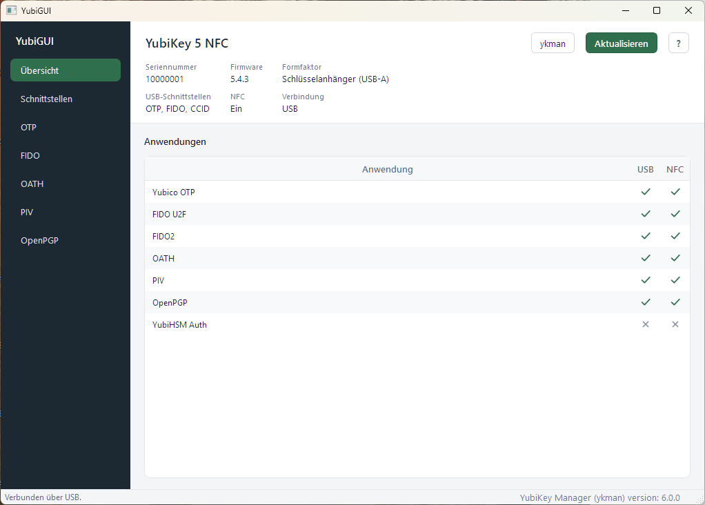
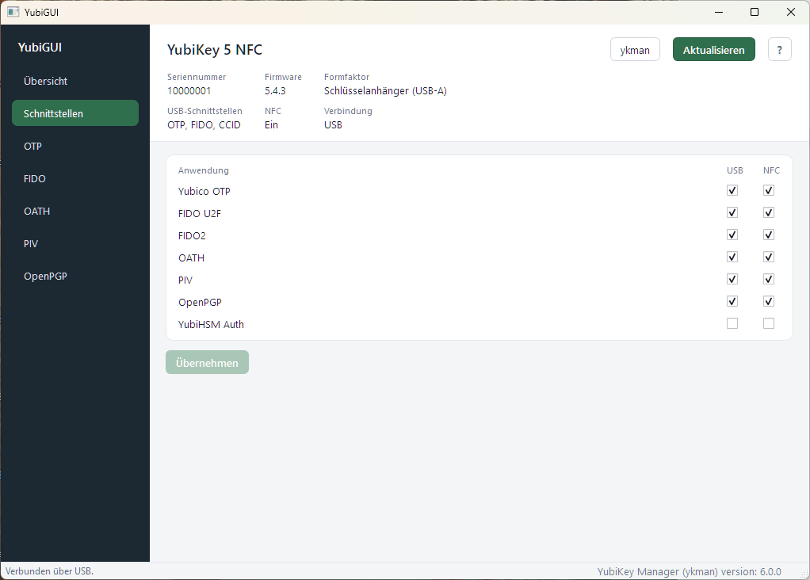
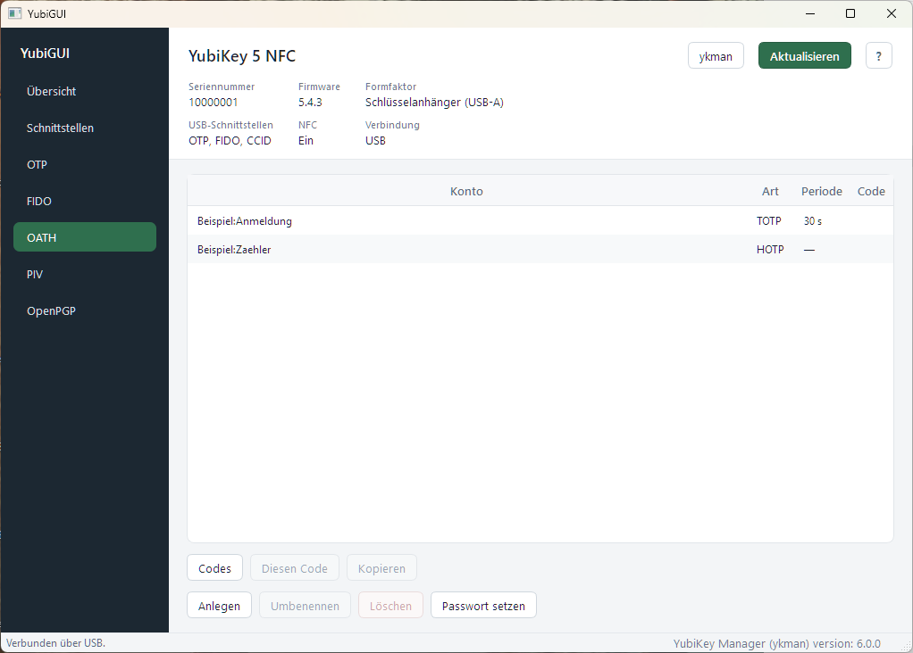
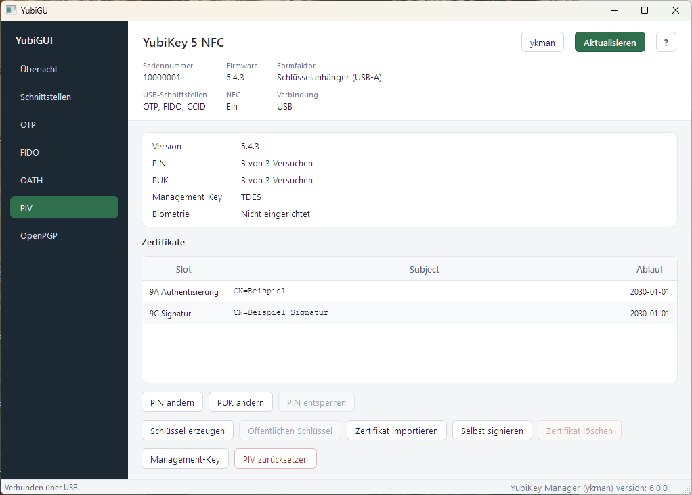

# YubiGUI

YubiGUI ist eine Qt-Widgets-Oberfläche für den YubiKey. Sie spricht den Key nicht selbst an. Jede Aktion startet das installierte `ykman` als eigenen Prozess, mit einer festen Liste von Argumenten, und zeigt das Ergebnis im Fenster.

Die Oberfläche ist deutsch. Dieselbe Projektdatei baut unter Windows und unter Linux.

YubiGUI ist kein Ersatz für den Yubico Authenticator im Alltag und kein Browser für WebAuthn. Es ist die Verwaltung, für die man sonst `ykman` in die Konsole holt: Anwendungen schalten, OTP-Slots, FIDO, OATH, PIV und OpenPGP. Es gibt keine Telemetrie und keinen Netzwerkaufruf. Firmware-Updates macht das Programm nicht.

Die Bilder weiter unten zeigen Beispieldaten. Es ist kein echter Key zu sehen.

## Voraussetzungen

- Qt 6 mit dem Modul Widgets. Gebaut wird mit qmake, nicht mit CMake.
- `ykman` 6. Die Fassung 5 kennt die Option `--color` nicht, die YubiGUI verwendet. Der Pfad lässt sich im Fenster unter **ykman** festlegen. Ohne eigenen Pfad sucht das Programm über `PATH` und, unter Windows, im Installationsordner des YubiKey Manager CLI.
- Unter Linux für PIV, OATH und OpenPGP der Dienst `pcscd` und die udev-Regeln von `yubikey-manager`. OTP und FIDO gehen über HID und brauchen `pcscd` nicht. Fehlt etwas, bietet die Schaltfläche **Pakete** die Befehle zum Kopieren an.
- Für einen SSH-Schlüssel auf dem FIDO-Modul `ssh-keygen`. Unter Windows ist das der optionale OpenSSH-Client.

Ein eigener Key wird über USB oder über ein Lesegerät angesprochen. `ykman` findet ihn. Mehrere Keys wählt man über die Seriennummer. Es wird immer genau ein Gerät bearbeitet.

## Bauen

Qt Creator: `YubiGUI.pro` öffnen und ein Qt-6-Kit wählen. MSVC und MinGW bauen dieselbe Datei.

Windows, auf der Kommandozeile, mit dem MinGW-Kit von Qt:

```text
mkdir build
cd build
qmake ..\YubiGUI.pro -spec win32-g++
mingw32-make
```

`qmake` und `mingw32-make` müssen aus dem gewählten Kit stammen.

Linux, mit Qt 6 aus dem Qt-Installer:

```text
mkdir -p build && cd build
qmake ../YubiGUI.pro
make
```

Das Ergebnis heißt `yubigui`.

## Bedienung

Links stehen die Seiten, oben der verbundene Key: Modell, Seriennummer, Firmware, Formfaktor, USB-Schnittstellen, NFC und die Art der Verbindung. Liegt der Key auf einem Lesegerät, steht dort **Lesegerät**. Fehlt der Key, wartet das Fenster. Der Text lautet dann, ihn einzustecken oder auf das Lesegerät zu legen.

**Aktualisieren** liest den Key neu. **?** erklärt die gerade offene Seite.

### Übersicht

Die Anwendungen des Keys, jeweils für USB und, wenn der Key NFC hat, für NFC. Ein Häkchen heißt eingeschaltet, ein Kreuz ausgeschaltet. YubiHSM Auth erscheint nur als Zeile. Diese Anwendung wird nicht bedient.



### Schnittstellen

Dieselben Anwendungen als Schalter. **Übernehmen** schreibt die Änderung. Ein schon gesetzter Lock-Code wird abgefragt. Einen neuen Lock-Code legt YubiGUI nicht an. Ändert sich eine USB-Schnittstelle, verbindet sich der Key kurz neu. Eine reine NFC-Änderung lässt die Verbindung stehen.



### OTP

Zwei Slots. Slot 1 löst eine kurze Berührung aus, Slot 2 eine lange. Sichtbar ist nur, ob ein Slot belegt ist. Den gespeicherten Inhalt gibt der Key nicht heraus, und die Oberfläche tut nicht so, als könnte sie ihn lesen.

Programmieren kann Yubico OTP, Challenge-Response, ein statisches Passwort oder HOTP. Programmieren, Löschen und Tauschen fragen vorher. Ein belegter Slot und das Tauschen verlangen die eingetippte Seriennummer. Ein erzeugtes Geheimnis wird einmal angezeigt.

### FIDO

Status des FIDO2-Moduls: ob ein PIN gesetzt ist, wie viele Versuche bleiben, die Mindestlänge, discoverable Credentials und der freie Speicher. Der PIN geht an die Standardeingabe von `ykman` und nie als `--pin` auf die Befehlszeile. Unter Windows kann genau dieser Aufruf eine erhöhte Sitzung brauchen. Die übrige Oberfläche bleibt ohne Erhöhung.

Auffindbare Anmeldedaten erscheinen erst nach dem PIN. Löschen gilt für einen Eintrag und verlangt die Seriennummer. Ein SSH-Schlüssel legt auf dem Rechner nur eine Stub-Datei und den öffentlichen Schlüssel an. Der private Schlüssel bleibt auf dem YubiKey. **Stubs holen** schreibt residente Schlüssel neu.

**FIDO zurücksetzen** löscht die FIDO2- und U2F-Anmeldedaten. Dafür muss die Seriennummer eingetippt werden. Danach wartet `ykman` auf Abziehen, Wiedereinstecken und die Berührung.

### OATH

Konten auf dem Key. Codes nur auf Wunsch und nur kurz. Sie landen nicht von selbst in der Zwischenablage. **Kopieren** tut das erst auf ausdrücklichen Druck. Anlegen aus einer `otpauth://`-Adresse, Umbenennen und Löschen sitzen auf derselben Seite. Löschen verlangt die Seriennummer.

Ein OATH-Passwort geht an die Konsole von `ykman`. YubiGUI speichert es nicht auf dem Rechner und bietet das Merken durch `ykman` nicht an.



### PIV

Versuche für PIN und PUK, der Management-Key und die Zertifikate in den Slots. PIN, PUK und Management-Key gehen an die Konsole von `ykman`. Ein Fehlversuch verbraucht einen Versuch. Ist die PIN gesperrt, entsperrt sie nur noch der PUK. Ist der PUK aufgebraucht, bleibt die PIV-Anwendung gesperrt.

Schlüssel erzeugen, Zertifikat importieren oder selbst signieren, Zertifikat löschen und den Management-Key wechseln fragen vorher. Ein belegter Slot, der Management-Key und der Reset verlangen die Seriennummer. Export schreibt nur den öffentlichen Schlüssel, als PEM oder OpenSSH. Eine Stub-Datei legt PIV nicht an. Ein erzeugter Management-Key wird einmal angezeigt.

Werkseinstellungen kennzeichnet die Übersicht, sobald `ykman` sie ausweist. Die Felder werden nicht mit den Werkswerten gefüllt.



### OpenPGP

Version, Versuche, Signatur-PIN, KDF und je Schlüssel Fingerabdruck und Berührung. Benutzer-PIN, Admin-PIN, Reset-Code, Signatur-PIN und die Berührung gehen an die Konsole von `ykman`. Eine feste Berührung verlangt die Seriennummer, weil sie sich später nicht wieder lockern lässt.

Ist die Benutzer-PIN gesperrt, nimmt `ykman` den Admin-PIN zum Entsperren nur als Argument. YubiGUI schickt ihn deshalb nicht. Schlüssel erzeugen bleibt bei GnuPG. YubiGUI verwaltet die Karte und wird kein zweites GnuPG.

## Was die Oberfläche nicht tut

PINs, PUKs, Passwörter, Management-Keys und andere Geheimnisse stehen nicht in der Befehlszeile, weil Argumente in der Prozessliste sichtbar sind. Sie werden nicht ins Log geschrieben, nicht in den Fenstertitel gesetzt und nicht in Fehlermeldungen wiederholt.

Zerstörende Aktionen verlangen die Seriennummer als Eingabe, nicht nur einen Knopf. Die Bestätigung passiert im Fenster, einmal und sichtbar. Ein stilles `--force` gibt es nicht.

Ein Fehlversuch bei FIDO, PIV oder OpenPGP verbraucht einen der wenigen Versuche. Die Hilfe der Seite sagt das, bevor etwas abgeschickt wird. Sind die FIDO-Versuche aufgebraucht, hilft nur ein FIDO-Reset, und der löscht die Anmeldedaten. Bei PIV folgt auf die PIN der PUK. Ist der PUK aufgebraucht, bleibt PIV gesperrt, bis ein Reset die Anwendung leert.

Die GUI startet sich nicht als Administrator und nicht über `sudo`. Unter Windows wird nur der einzelne FIDO-Aufruf erhöht, wenn der direkte Zugriff abgelehnt wird. Hält ein anderes Programm die Smartcard, sagt das Fenster das und probiert nicht in einer Schleife weiter. Unter Linux ist das oft `scdaemon` aus GnuPG.

Blinkt der Key, wartet das Fenster auf die Berührung. Der Abbruch beendet den `ykman`-Prozess, damit ein hängender Touch den Key nicht blockiert.

## Einstellungen

Der Pfad zu `ykman` liegt im Konfigurationsordner des Benutzers, über `QStandardPaths`. Unter Linux ist das `$XDG_CONFIG_HOME/yubigui` beziehungsweise `~/.config/yubigui`, unter Windows der übliche AppData-Pfad. In der Datei steht kein Schlüssel und kein PIN.

## Projekt

```text
YubiGUI.pro    qmake
src/           Qt Widgets
docs/bilder/   Bilder dieser README, mit Beispieldaten
```

`build/` gehört nicht ins Repository. Die `.gitignore` lässt ihn draußen, zusammen mit den Benutzerdateien von Qt Creator.
